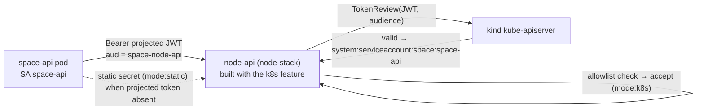

# Projected-token (Kubernetes TokenReview) auth — local PoC

Scripts to wire and test SPACE's **projected ServiceAccount token** internal-auth
path (`mode:k8s`) on a local `kind` cluster, as an alternative to the static
`SPACE_INTERNAL_TOKEN` bearer (`mode:static`).

In Kubernetes mode, the internal gRPC server forwards the caller's projected
ServiceAccount JWT to the kube-apiserver's TokenReview API with the expected
audience. The verified `system:serviceaccount:<ns>:<name>` must also match the
allowlist for the requested surface. This harness enables static-token fallback
so clients without a projected token can still use `SPACE_INTERNAL_TOKEN`;
deployments can disable that fallback.



## Why this needs a special build + a direct RPC test

Two local-only wrinkles, both real:

1. **The dev node-stack image is built k8s-free.** The `build-node-stack` lane in
   `docker/Dockerfile.rust-build-common` omits the `k8s` Cargo feature, so the
   local node-api has no TokenReview code. With `k8sAuth` enabled it would
   **fail loud** (`KubernetesAuthFeatureDisabled`). `00-enable-node-stack-k8s-build.sh`
   adds the feature for a local rebuild (revert before committing — we do not
   ship k8s in the dev image).

2. **The full async create flow doesn't traverse this edge locally.** The local
   stack runs **DirectSubstrate** (space-api dials the node-stack DaemonSet's
   node-api directly — this is the edge where `mode:k8s` lives). The async
   operation processor is the **cluster-controller**, which requires
   `SPACE_K8S_CONTROL_PLANE=true` (**KubernetesSubstrate**) and creates a
   **per-sandbox Pod** instead of calling the DaemonSet's node-api. So a
   `POST /v1/sandboxes` in non-MINIMAL would route around this edge entirely.
   We therefore exercise the path with a **direct `WorkerApi` RPC** carrying
   space-api's real projected token — the node-api auth behaviour is identical
   to what the DirectSubstrate client does.

## Prerequisites

- A running local stack on `kind` (see the
  [installation guide](../../../docs/installation.md) and `Tiltfile`).
  The Tiltfile names the cluster from `SPACE_KIND_CLUSTER` (built-in default
  `space-local-3486`); these examples pass `SPACE_KIND_CLUSTER=space-local`, but
  either name works — the scripts default `KCTX` to your **current kube-context**
  (whatever Tilt left selected) and refuse any non-`kind-*` context. MINIMAL mode
  is fine.
- `kubectl`, `grpcurl` (`brew install grpcurl`), and `nc`.
- node-stack built **with** the k8s feature (step 0 below).

## Usage

```bash
cd scripts/k8s/projected-tokens

# 0. (dev-only) add the k8s feature to the node-stack build lane, then rebuild.
./00-enable-node-stack-k8s-build.sh
SPACE_KIND_CLUSTER=space-local tilt up          # rebuilds node-stack with k8s

# 1. wire the auth: TokenReview RBAC + node-stack k8sAuth env + space-api
#    projected token. Idempotent; re-run after any `tilt up` reconcile.
./01-apply-auth.sh

# 2. prove it: positive (ListSandboxes + CreateSandbox accepted via TokenReview)
#    and negative (bogus JWT rejected).
./02-test.sh

# 3. (optional) revert the wiring back to static-only auth.
./03-teardown.sh
```

All knobs (context, namespace, SAs, audiences, allowlist) are overridable via
the environment — see `lib.sh`. `KCTX` defaults to your current kube-context; set
`KCTX=kind-<name>` to target a specific cluster.

## Policy authorization and rollout

Before enabling Kubernetes auth or upgrading an authenticated worker or builder,
configure `SPACE_NODE_API_AUTH_TRUSTED_POLICY_SERVICE_ACCOUNTS` with the service
accounts that own policy intent. It must be nonempty on both roles or node-api
refuses startup. This setup supplies `NODE_API_TRUSTED_POLICY_SAS`, defaulting to
`space-api,space-cluster-controller`; override it for your deployment. These
accounts must also be admitted by the normal/internal surface allowlists for the
RPCs they call. Policy trust is independent of the WaitReady trust set.
The setup projects both normal and internal audience tokens into space-api; the
internal token is required for policy-bearing pool adoption.

Shared static-token fallback cannot mutate policy when Kubernetes auth is enabled.
Static-only deployments retain that authority. Policy-bearing cold creation,
internal pool adoption, and worker/builder template updates require a trusted
caller. Cold creation and pool adoption also require policy authority for a nonzero
sandbox-policy generation, even without an override. No overrides and generation
zero remain available to otherwise admitted callers and inherit template policy.
Admitted service accounts and shared fallback credentials are the relevant threat:
guest-bridge accounts already have separate method restrictions.

`Local` means node-administrator-owned policy, including normal standalone use and
operator overrides on cluster-managed nodes. It requires a root/Operator Unix
socket peer. Forwarders such as node-api and node-ctl must run under their dedicated
non-root identities: UID 0 is classified as Root before service-account lookup.

Forwarded imports carrying `Local` network or auto-lifecycle policy are intentionally
rejected. Retrying does not help. An operator must review the policy ownership and
perform the import through an authorized local peer when retaining Local policy;
forwarding must never silently relabel it.

## What success looks like

After `01-apply-auth.sh`, node-api boots:

```
node-api auth initialized  role=Worker  mode=k8s_token_review  static_fallback_enabled=true
```

`02-test.sh` then shows node-api validating space-api's projected JWT against the
kind apiserver:

```
[pt] POSITIVE 1/2: ListSandboxes ...        -> {}              (accepted)
[pt] POSITIVE 2/2: CreateSandbox ...        -> handler ran past auth
[pt] NEGATIVE: bogus JWT ...                -> Unauthenticated: token validation failed
[pt] node-api TokenReview decisions:
  ACCEPT  sa=system:serviceaccount:space:space-api  aud=space-node-api  surface=normal
```

The `CreateSandbox` handler may fail *after* auth (no bootable guest in kind);
that's expected — the point is the `ACCEPT` line, which proves the projected
token was validated via TokenReview and matched the allowlist (`mode:k8s`).

## Troubleshooting

**kind API liveness timeouts during the `tilt up`/`tilt ci` build.** kind runs the
whole control plane (apiserver + etcd) inside one Docker container, sharing the
VM's CPU/RAM/disk with the image builds. Heavy *parallel* Rust image builds (plus
the per-image `kind load`) saturate that VM and starve etcd — its `wal` fsync
latency spikes, the apiserver can't reach it, and the build fails with a kind API
liveness timeout (or a wedged apiserver that returns TLS-handshake timeouts). If
you hit this:

- Build **sequentially** or bound parallelism — start Tilt with
  `SPACE_TILT_MAX_PARALLEL_UPDATES=1` (or `2`) in its environment; the Tiltfile
  reads it (`tilt up` has no parallelism flag). The MINIMAL bench defaults to 3,
  the full harness to 8. Slower, but it keeps the control plane responsive. `tilt ci` is the most likely to trip
  this since it gates on everything going green in one shot.
- Prefer a **local image registry** (`kind-with-registry`) — it removes the
  `kind load` IO entirely (containerd pulls directly), which is the single biggest
  reduction in pressure. Tilt warns when you're running kind without one.
- Give the **Docker VM more CPU/RAM** if it's under-provisioned.

## Files

| File | Purpose |
| --- | --- |
| `lib.sh` | Shared config (context, namespace, SAs, audiences, ports) + helpers |
| `00-enable-node-stack-k8s-build.sh` | Dev-only: add the `k8s` feature to the node-stack build lane |
| `01-apply-auth.sh` | Wire TokenReview RBAC + server env + client projected token |
| `02-test.sh` | Positive + negative TokenReview tests via `grpcurl` |
| `03-teardown.sh` | Revert the wiring to static-only auth |
